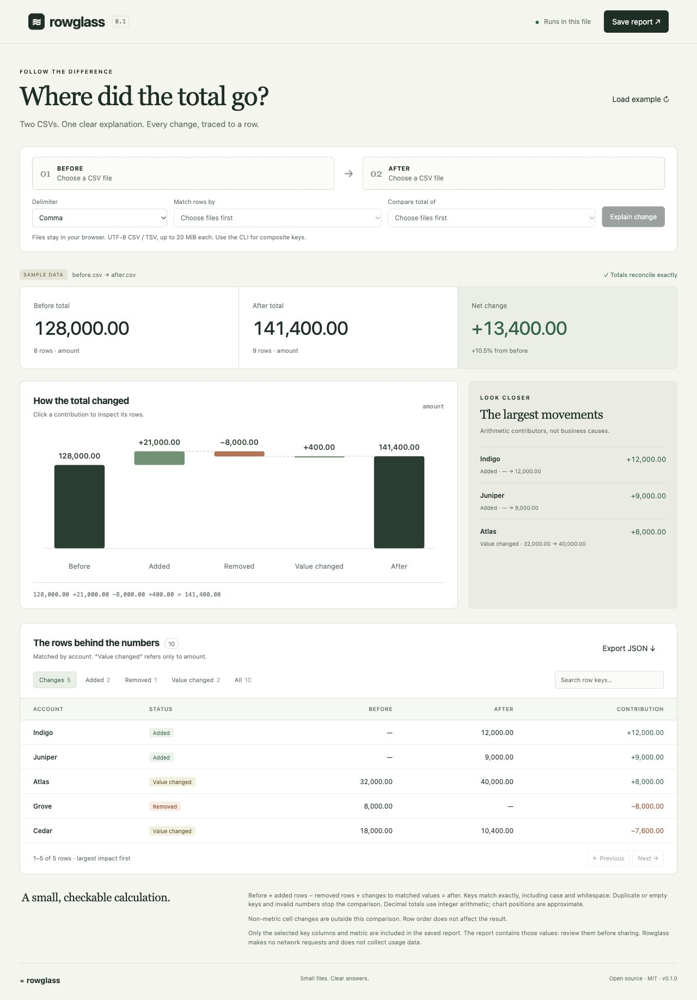

# Rowglass

[브라우저에서 바로 사용](https://kwakhyun.github.io/rowglass/) | [GitHub 저장소](https://github.com/kwakhyun/rowglass)

**CSV 합계의 차이를 행별로 확인하세요.**

두 CSV 파일과 행을 구분할 키, 합산할 숫자 열을 고르면 합계가 얼마나 달라졌는지 보여줍니다. 추가된 행, 삭제된 행, 기존 행의 값 변경을 나눠 확인하고, 결과를 오프라인에서 열리는 HTML 파일 하나로 저장할 수 있습니다.

[English](README.md) · [예시 보고서](examples/report.html) · [기여 안내](CONTRIBUTING.md)



기본 예제는 설명을 위해 만든 데이터입니다. 합계가 **128,000에서 141,400으로** 바뀐 과정을 보여줍니다.

```text
128,000 + 추가된 값 21,000 − 삭제된 값 8,000 + 기존 값의 변화 400 = 141,400
```

Atlas는 8,000 증가했고 Cedar는 7,600 감소했습니다. 두 행의 변화를 합치면 400이지만, 보고서에서는 각각의 변화를 따로 확인할 수 있습니다.

## 바로 사용하기

[examples/report.html](examples/report.html)을 내려받아 최신 브라우저에서 여세요. 예제를 살펴보거나 자신의 파일을 선택할 수 있습니다. GitHub에서 HTML 소스가 보이면 파일을 다운로드한 뒤 열면 됩니다.

소스 코드에서 실행하려면 **Node.js 22 이상**이 필요합니다. 프로젝트 폴더에서 다음 명령을 실행하세요.

```sh
npm test
npm run build
```

생성된 `dist/index.html`을 브라우저에서 엽니다. macOS에서는 다음 명령을 쓸 수 있습니다.

```sh
open dist/index.html
```

별도로 설치할 npm 의존성은 없습니다. 아직 npm에 배포하지 않았으므로 아래의 소스 코드 실행 명령을 사용하세요.

브라우저에서 변경 전후 파일을 선택하고 구분자, 키 열, 숫자 열을 확인한 뒤 **Explain change**를 누르세요. 차트에서 항목을 누르면 해당 행만 볼 수 있습니다. 키 검색과 행별 상세 보기도 지원합니다. **Save report**로 HTML을, **Export JSON**으로 계산 결과를 저장합니다.

## CLI 사용하기

```sh
node bin/rowglass.mjs examples/before.csv examples/after.csv --key account --value amount --out report.html --json report.json
```

여러 열을 함께 키로 쓰려면 `--key`를 반복합니다. TSV에는 `--delimiter tab`을 지정하세요.

```sh
node bin/rowglass.mjs before.tsv after.tsv --key account --key region --value amount --delimiter tab --out report.html
```

예시 보고서와 재사용할 브라우저 앱도 만들 수 있습니다.

```sh
node bin/rowglass.mjs demo --out demo.html
node bin/rowglass.mjs app --out rowglass.html
node bin/rowglass.mjs --help
```

`--out`은 필수입니다. 기존 결과 파일을 덮어쓰려면 `--force`가 필요합니다. 원본 입력 파일은 `--force`를 지정해도 덮어쓸 수 없습니다. 브라우저는 자동으로 열지 않습니다.

스크립트나 CI에서는 `--fail-on-change`를 추가할 수 있습니다.

| 종료 코드 | 의미 |
| --- | --- |
| `0` | 정상 완료. `--fail-on-change`가 없으면 차이가 있어도 정상 종료합니다. |
| `1` | 잘못된 인자, 유효하지 않은 데이터 또는 출력 오류가 발생했습니다. |
| `2` | `--fail-on-change`를 지정했고 추가, 삭제 또는 숫자 값이 바뀐 행이 있습니다. 보고서는 저장됩니다. |

값이 0인 행의 추가나 삭제도 코드 `2`를 반환합니다. 여러 행의 증감이 상쇄되어 전체 합계가 같아도 마찬가지입니다. 행 순서, `1.0`과 `1.00`처럼 숫자를 적는 방식, 다른 열의 셀 값 변경은 여기에 포함하지 않습니다.

## 계산 범위

키가 같은 행은 **변경 후 값 − 변경 전 값**을 계산합니다. 추가된 행은 새 값 전체를 더하고, 삭제된 행은 기존 값의 부호를 바꿔 더합니다. 따라서 음수 값이 있던 행을 삭제하면 합계는 증가합니다.

```text
변경 전 합계 + 추가 행의 기여분 + 삭제 행의 기여분 + 기존 행의 변화 = 변경 후 합계
```

정수 기반 연산으로 소수 합계를 정확히 계산합니다. 차트 위치는 근삿값을 사용하지만 표와 JSON에는 정확한 소수 문자열을 유지합니다. 행별 숫자 차이를 설명하며, 매출 증감 같은 비즈니스 원인을 추론하지는 않습니다.

| 항목 | 지원 범위 |
| --- | --- |
| 파일 | 헤더가 있는 UTF-8 CSV 또는 TSV. 파일당 최대 20 MiB, 데이터 행 100,000개. |
| CSV 형식 | 따옴표로 감싼 구분자, 이스케이프된 따옴표, 여러 줄 필드, LF/CRLF 줄바꿈, UTF-8 BOM. 빈 줄은 건너뜁니다. |
| 키 | 비어 있지 않고 파일 안에서 고유해야 합니다. 대소문자와 공백까지 정확히 비교합니다. 브라우저는 키 한 개, CLI와 API는 복합 키를 지원합니다. |
| 숫자 | 열 하나를 비교합니다. 값마다 정수부 최대 30자리, 소수부 최대 12자리이며 음수도 지원합니다. |
| 오류 처리 | 빈 헤더나 중복 헤더, 잘못된 레코드, 비어 있거나 중복된 키, 선택한 열의 누락, 잘못된 숫자가 있으면 비교를 중단합니다. |

숫자는 `12`, `12.50`, `-0.25`와 같이 적어야 합니다. 빈 값, 앞뒤 공백, `+12`, `.5`, 지수 표기, 통화 기호, 자릿수 구분자는 허용하지 않습니다. 반올림이나 통화 및 단위 변환은 하지 않으므로 같은 의미와 단위의 값을 비교하세요.

추가되거나 삭제된 열 이름은 기록하지만, 선택한 숫자 열 외의 셀 값 변화는 비교하지 않습니다. Excel 파일, 데이터베이스 연결, 자동 키 매칭은 현재 지원하지 않습니다.

## 파일과 보고서

서버나 업로드 없이 로컬에서 동작하며 네트워크 요청과 사용 통계 수집을 하지 않습니다. 생성된 HTML에는 실행 코드, 스타일, 보고서 데이터가 함께 들어 있습니다.

저장된 보고서에는 변경되지 않은 행을 포함한 모든 키와 선택한 숫자 값이 담깁니다. 파일명, 열 이름, 합계와 행 상태도 저장하며 다른 열의 셀 값은 제외합니다. 보고서를 공유하기 전에 포함된 데이터를 확인하세요.

## 코드에서 사용하기

Node.js와 브라우저에서 같은 ESM 엔진을 사용합니다.

```js
import { parseCSV, reconcile } from './src/engine.mjs';

const before = parseCSV('account,amount\nAtlas,0.10\n');
const after = parseCSV('account,amount\nAtlas,0.30\n');
const report = reconcile(before, after, {
  keys: ['account'],
  value: 'amount',
  beforeName: 'before.csv',
  afterName: 'after.csv',
});

console.log(report.totals.delta); // "0.20"
console.log(report.rows[0].status); // "changed"
```

TSV는 `parseCSV(text, { delimiter: '\t' })`로 읽습니다. 반환값은 `{ headers, rows }`입니다. `reconcile()`은 `totals`와 `rows`에 소수 문자열을, `counts`에 행 개수를 담습니다. `schema`에는 추가되거나 삭제된 열 이름을 기록합니다. 해당 시점에 존재하지 않는 행의 값은 `null`이며, 입력이 잘못되면 오류를 던집니다.

## 관련 프로젝트

| 프로젝트 | 주요 용도 |
| --- | --- |
| [csv-diff](https://github.com/simonw/csv-diff) | CSV, TSV, JSON 파일의 행과 셀 차이를 확인하는 Python CLI와 라이브러리. |
| [daff](https://github.com/paulfitz/daff) | 표 비교, 변경 사항 적용, 병합과 차이 표시. |
| [dataloupe](https://github.com/aurelio-nakamura/dataloupe) | 데이터를 독립된 HTML 파일에서 오프라인으로 탐색. |
| Rowglass | 두 CSV의 합계 차이를 계산하고 각 행이 얼마나 기여했는지 확인. |

## 개발

`npm test`로 엔진과 CLI 테스트를 실행합니다. 브라우저 코드를 수정한 뒤에는 `npm run build`로 HTML을 다시 만드세요. 파일 구성과 브라우저 확인 항목은 [CONTRIBUTING.md](CONTRIBUTING.md)에 있습니다.

초기 테스트는 macOS와 Node.js 22에서 실행했습니다. GitHub Actions에는 Linux, macOS, Windows에서 Node.js 22와 24를 검사하는 구성을 넣었으며, 해당 원격 CI 작업은 아직 실행하지 않았습니다.

[MIT 라이선스](LICENSE)로 제공합니다.
