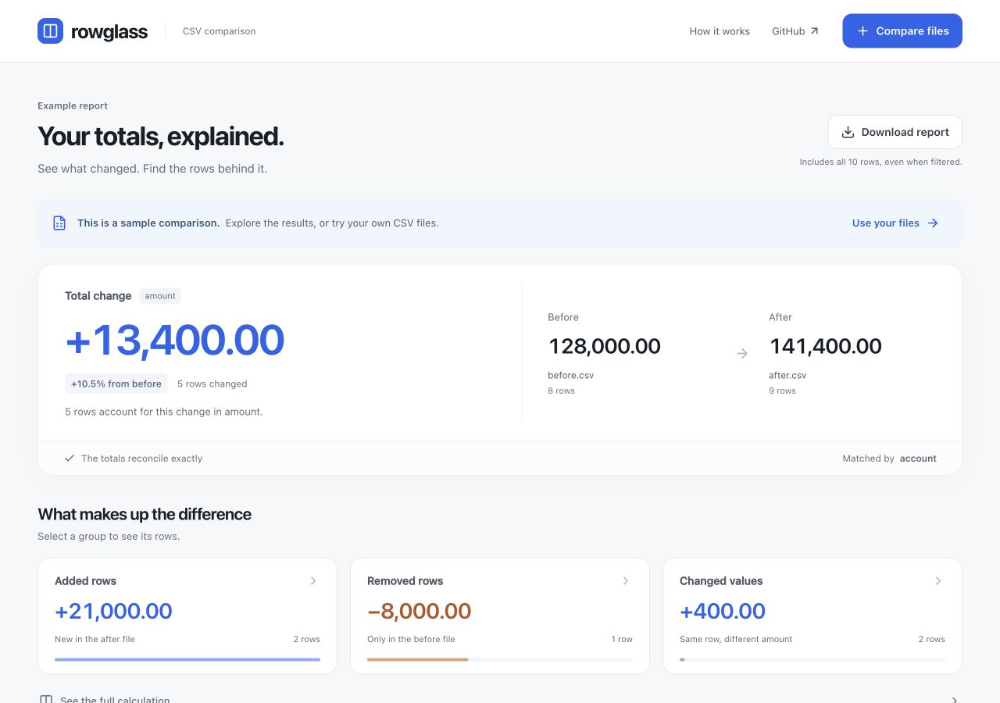

# Rowglass

[브라우저에서 바로 사용](https://kwakhyun.github.io/rowglass/) | [GitHub 저장소](https://github.com/kwakhyun/rowglass)

**CSV 합계의 차이를 행별로 확인하세요.**

두 CSV의 매출, 비용, 사용량 합계를 비교합니다. 하나 이상의 키로 개별 행을 맞추거나, 반복된 청구 항목을 고객과 서비스별로 합산할 수 있습니다. 추가, 삭제, 값 변경이 합계에 얼마나 기여했는지 확인하고 오프라인 HTML 보고서로 저장하세요.

[English](README.md) · [예시 보고서](examples/report.html) · [기여 안내](CONTRIBUTING.md)



기본 예제는 설명을 위해 만든 데이터입니다. 합계가 **128,000에서 141,400으로** 바뀐 과정을 보여줍니다.

```text
128,000 + 추가된 값 21,000 − 삭제된 값 8,000 + 기존 값의 변화 400 = 141,400
```

Atlas는 8,000 증가했고 Cedar는 7,600 감소했습니다. 두 행의 변화를 합치면 400이지만, 보고서에서는 각각의 변화를 따로 확인할 수 있습니다.

## 이런 작업에 적합합니다

- 월별 고객 매출에서 가장 크게 증가하거나 감소한 항목 찾기
- 여러 비용 또는 사용량 행을 계정과 서비스별로 합산해 기간 비교하기
- CI에서 숫자 값의 변화를 검사하고 차이가 있으면 보고서 남기기

같은 의미와 단위를 가진 숫자 열 하나를 비교하는 도구입니다. 비즈니스 원인을 추론하거나 모든 셀을 비교하는 스프레드시트 도구를 대체하지는 않습니다.

## 바로 사용하기

[examples/report.html](examples/report.html)을 내려받아 최신 브라우저에서 여세요. 예제를 살펴보거나 자신의 파일을 선택할 수 있습니다. GitHub에서 HTML 소스가 보이면 파일을 다운로드한 뒤 열면 됩니다.

소스 코드에서 실행하려면 **Node.js 22 이상**이 필요합니다. 프로젝트 폴더에서 다음 명령을 실행하세요.

```sh
npm test
npm run build
```

생성된 `dist/index.html`을 브라우저에서 엽니다. macOS에서는 다음 명령을 쓸 수 있습니다.

```sh
open dist/index.html
```

별도로 설치할 npm 의존성은 없습니다. 아직 npm에 배포하지 않았으므로 아래의 소스 코드 실행 명령을 사용하세요.

**Compare files**를 눌러 변경 전후 파일과 키, **Column to total**의 숫자 열을 고르세요. 복합 키는 **Add key columns**에서 추가합니다. 기본 **Match unique rows**는 중복 키를 거부합니다. 같은 고객이나 서비스의 반복 항목을 합산하려면 **Group & sum**을 직접 선택하세요. TSV는 **File format and limits**에서 구분자를 Tab으로 바꿉니다. **Try line-item costs**를 누르면 파일 없이 그룹 합산 예제를 볼 수 있습니다.

합계 증감액을 먼저 확인하고 추가, 삭제, 값 변경 카드를 눌러 해당 행을 볼 수 있습니다. 키 검색, 정렬, 행별 상세 보기도 지원합니다. 모바일에서는 행마다 변경 전후 값과 증감액을 함께 표시합니다.

**Download report**는 HTML을 저장합니다. **Export data**에서는 전체 JSON, 모든 변경행 CSV, 변화가 큰 상위 10개를 포함한 Markdown 요약을 저장합니다. 표 필터는 내보내기 범위에 영향을 주지 않습니다. 파일이나 열을 바꿨다면 비교를 실행하거나 변경을 폐기한 뒤 저장하세요. 인쇄에는 현재 표 페이지와 표시 범위가 포함됩니다.

## CLI 사용하기

```sh
node bin/rowglass.mjs examples/before.csv examples/after.csv --key account --value amount --out report.html --json report.json
```

여러 열을 함께 키로 쓰려면 `--key`를 반복합니다. TSV에는 `--delimiter tab`을 지정하세요.

```sh
node bin/rowglass.mjs before.tsv after.tsv --key account --key region --value amount --delimiter tab --out report.html
```

같은 계정과 서비스의 반복 항목을 합산하고 CSV와 요약을 함께 저장할 수 있습니다.

```sh
node bin/rowglass.mjs examples/usage-before.csv examples/usage-after.csv --group-by account --group-by service --value cost --out costs.html --csv changes.csv --markdown summary.md --json costs.json
```

가상 비용 예제의 계산은 `285.30 + 50.00 − 35.00 + 10.00 = 310.30`입니다. `--key`와 `--group-by`는 함께 쓸 수 없습니다. `--csv`와 `--markdown`은 개별 행 비교에도 사용할 수 있습니다.

예시 보고서와 재사용할 브라우저 앱도 만들 수 있습니다.

```sh
node bin/rowglass.mjs demo --out demo.html
node bin/rowglass.mjs app --out rowglass.html
node bin/rowglass.mjs --help
```

`--out`은 필수입니다. 기존 결과 파일을 덮어쓰려면 `--force`가 필요합니다. 원본 입력 파일은 `--force`를 지정해도 덮어쓸 수 없습니다. 브라우저는 자동으로 열지 않습니다.

스크립트나 CI에서는 `--fail-on-change`를 추가할 수 있습니다.

| 종료 코드 | 의미 |
| --- | --- |
| `0` | 정상 완료. `--fail-on-change`가 없으면 차이가 있어도 정상 종료합니다. |
| `1` | 잘못된 인자, 유효하지 않은 데이터 또는 출력 오류가 발생했습니다. |
| `2` | `--fail-on-change`를 지정했고 추가, 삭제 또는 숫자 값이 바뀐 행이 있습니다. 보고서는 저장됩니다. |

그룹 모드의 상태와 종료 코드는 그룹 합계를 기준으로 합니다. 한 그룹 안에서 증감이 상쇄되거나 원본 행 개수만 바뀌면 코드 `2`를 반환하지 않습니다. 합계가 0인 그룹이 추가되거나 삭제되면 반환합니다. 차이가 있어도 보고서와 작업 요약을 보존하는 방법은 [CI 사용법](docs/ci.md)을 참고하세요.

개별 행 모드에서는 값이 0인 행의 추가나 삭제도 코드 `2`를 반환합니다. 여러 행의 증감이 상쇄되어 전체 합계가 같아도 마찬가지입니다. 행 순서, `1.0`과 `1.00`처럼 숫자를 적는 방식, 다른 열의 셀 값 변경은 여기에 포함하지 않습니다.

## 계산 범위

키가 같은 행은 **변경 후 값 − 변경 전 값**을 계산합니다. 추가된 행은 새 값 전체를 더하고, 삭제된 행은 기존 값의 부호를 바꿔 더합니다. 따라서 음수 값이 있던 행을 삭제하면 합계는 증가합니다.

```text
변경 전 합계 + 추가 행의 기여분 + 삭제 행의 기여분 + 기존 행의 변화 = 변경 후 합계
```

정수 기반 연산으로 소수 합계를 정확히 계산합니다. 차트 위치는 근삿값을 사용하지만 표와 내보낸 파일에는 정확한 소수 문자열을 유지합니다. 스프레드시트 프로그램은 CSV의 숫자를 반올림할 수 있으므로 모든 자릿수를 유지해야 한다면 해당 열을 텍스트로 가져오세요. 행별 숫자 차이를 설명하며, 매출 증감 같은 비즈니스 원인을 추론하지는 않습니다.

| 항목 | 지원 범위 |
| --- | --- |
| 파일 | 헤더가 있는 UTF-8 CSV 또는 TSV. 파일당 최대 20 MiB, 데이터 행 100,000개. |
| CSV 형식 | 따옴표로 감싼 구분자, 이스케이프된 따옴표, 여러 줄 필드, LF/CRLF 줄바꿈, UTF-8 BOM. 빈 줄은 건너뜁니다. |
| 키 | 브라우저, CLI, API 모두 하나 이상의 비어 있지 않은 키를 지원합니다. 대소문자와 공백까지 정확히 비교합니다. 기본은 고유 키이며, 그룹 모드에서는 같은 키를 합산합니다. |
| 숫자 | 열 하나를 비교합니다. 값마다 정수부 최대 30자리, 소수부 최대 12자리이며 음수도 지원합니다. |
| 오류 처리 | 빈 헤더나 중복 헤더, 잘못된 레코드, 빈 키, 개별 행 모드의 중복 키, 선택한 열의 누락, 잘못된 숫자가 있으면 비교를 중단합니다. |

숫자는 `12`, `12.50`, `-0.25`와 같이 적어야 합니다. 빈 값, 앞뒤 공백, `+12`, `.5`, 지수 표기, 통화 기호, 자릿수 구분자는 허용하지 않습니다. 반올림이나 통화 및 단위 변환은 하지 않으므로 같은 의미와 단위의 값을 비교하세요.

추가되거나 삭제된 열 이름은 기록하지만, 선택한 숫자 열 외의 셀 값 변화는 비교하지 않습니다. Excel 파일, 데이터베이스 연결, 자동 키 매칭은 현재 지원하지 않습니다.

## 파일과 보고서

서버나 업로드 없이 로컬에서 동작하며 네트워크 요청과 사용 통계 수집을 하지 않습니다. 생성된 HTML에는 실행 코드, 스타일, 보고서 데이터가 함께 들어 있습니다.

HTML과 JSON에는 변경되지 않은 결과를 포함한 모든 키와 숫자 값, 파일명, 열 이름, 합계, 상태가 담깁니다. 그룹 모드에서는 개별 원본 행 대신 합계와 원본 행 개수를 저장합니다. CSV에는 모든 변경 결과가, Markdown에는 요약과 최대 10개의 변화가 들어갑니다. 다른 열의 셀 값과 원본 파일은 제외합니다. 공유 전에 포함된 데이터를 확인하세요.

스프레드시트 수식으로 해석될 수 있는 CSV 키 앞에는 작은따옴표를 붙입니다. 해당 키의 CSV 표현은 의도적으로 달라지며 JSON에는 원문을 유지합니다.

## 코드에서 사용하기

Node.js와 브라우저에서 같은 ESM 엔진을 사용합니다.

```js
import { parseCSV, reconcile } from './src/engine.mjs';

const before = parseCSV('account,amount\nAtlas,0.10\n');
const after = parseCSV('account,amount\nAtlas,0.30\n');
const report = reconcile(before, after, {
  keys: ['account'],
  value: 'amount',
  beforeName: 'before.csv',
  afterName: 'after.csv',
});

console.log(report.totals.delta); // "0.20"
console.log(report.rows[0].status); // "changed"
```

TSV는 `parseCSV(text, { delimiter: '\t' })`로 읽습니다. 반환값은 `{ headers, rows }`입니다. `reconcile()`은 `totals`와 `rows`에 소수 문자열을, `counts`에 행 개수를 담습니다. `schema`에는 추가되거나 삭제된 열 이름을 기록합니다. 해당 시점에 존재하지 않는 행의 값은 `null`이며, 입력이 잘못되면 오류를 던집니다.

그룹 합산은 `reconcile()`에 `aggregate: true`를 전달합니다. 결과에 `aggregation: 'sum'`과 `sourceCounts`가 추가되고 각 행에는 `beforeCount`, `afterCount`가 들어갑니다. 이때 `counts`는 그룹 개수입니다. `src/exports.mjs`의 `renderChangesCSV(report)`, `renderMarkdown(report)`로 브라우저와 동일한 텍스트 결과를 만들 수 있습니다.

## 관련 프로젝트

| 프로젝트 | 주요 용도 |
| --- | --- |
| [csv-diff](https://github.com/simonw/csv-diff) | CSV, TSV, JSON 파일의 행과 셀 차이를 확인하는 Python CLI와 라이브러리. |
| [daff](https://github.com/paulfitz/daff) | 표 비교, 변경 사항 적용, 병합과 차이 표시. |
| [dataloupe](https://github.com/aurelio-nakamura/dataloupe) | 데이터를 독립된 HTML 파일에서 오프라인으로 탐색. |
| [CSV Compare](https://csvtodashboard.com/csv-compare) | 브라우저에서 합계와 범주별 기여를 비교하고 보고서를 저장. |
| Rowglass | 정확한 소수 계산, 명시적 그룹 합산, 오프라인 보고서에 집중한 작은 MIT 라이선스 JavaScript 도구. |

오프라인 HTML, 키 기반 비교, 합계 정산은 다른 도구에도 있습니다. Rowglass는 코드를 살펴보기 쉬운 작은 엔진과 한 가지 작업 흐름에 집중합니다. 다른 도구보다 빠르거나 정밀하다는 비교 검증은 하지 않았습니다.

## 개발

`npm test`로 엔진, 내보내기, 렌더러, CLI를 검사합니다. `npm run check:package`는 로컬 패키지 파일을 오프라인으로 설치해 별도 폴더에서 실행합니다. 브라우저 코드를 수정한 뒤에는 `npm run build`로 HTML을 다시 만드세요. 파일 구성과 브라우저 확인 항목은 [CONTRIBUTING.md](CONTRIBUTING.md)에 있습니다.

Linux, macOS, Windows와 Node.js 22, 24의 GitHub Actions 조합이 모두 통과했습니다. 정확한 실행 기록과 브라우저 확인 범위는 [검증 기록](docs/verification.md)에 있습니다. 사용자 채택률이나 성능 향상을 측정했다는 주장은 하지 않습니다.

[MIT 라이선스](LICENSE)로 제공합니다.
