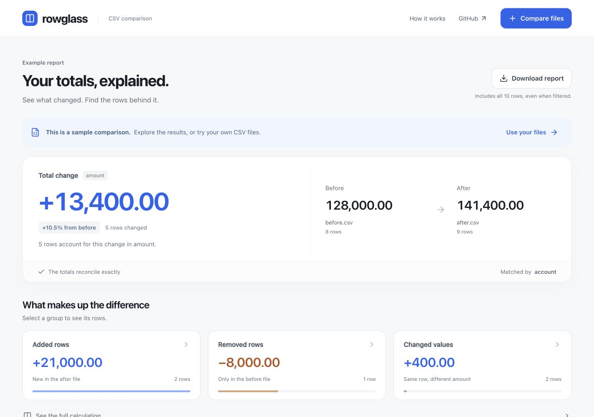

# Rowglass

**Explain a changed CSV total, down to the rows.**

Reconcile revenue, cost, or usage totals across two CSV exports. Match unique records with one or more keys, or explicitly sum repeated line items by customer, account, or service. See what added, removed, and changed values contribute, then save an interactive offline HTML report.

[Try the live demo](https://kwakhyun.github.io/rowglass/) · [한국어 안내](README.ko.md) · [Example report](examples/report.html) · [Contributing](CONTRIBUTING.md)



The bundled synthetic example goes from **128,000 to 141,400**:

```text
128,000 + 21,000 added − 8,000 removed + 400 changed = 141,400
```

Atlas increased by 8,000 while Cedar decreased by 7,600. Their combined contribution is just 400; the report lets you inspect both rows.

## When it fits

- Compare monthly customer totals and find the largest increases and decreases.
- Sum repeated cost or usage records by account and service before comparing periods.
- Check a numeric snapshot in CI and keep a report when the check fails.

This is a focused reconciliation utility. It compares one metric with the same meaning and unit in both files; it does not explain business causes or replace a general spreadsheet diff.

## Try it

Download and open [examples/report.html](examples/report.html) in a modern browser. It includes the example and accepts your own files. GitHub may display the HTML source; download the file first.

Clone the repository with **Node.js 22 or newer**:

```sh
git clone https://github.com/kwakhyun/rowglass.git
cd rowglass
npm test
npm run build
```

Open `dist/index.html` in your browser. On macOS:

```sh
open dist/index.html
```

There are no npm dependencies to install. The package has not been published to npm; use the checkout commands below.

Select **Compare files**, choose the before and after CSVs, and confirm the keys and **Column to total**. You can also drop both files anywhere on the page. Words where the two names differ decide the order (before/after, old/new, prev/current, 전/후 as in 이전/이후 or 변경전/변경후), a numbered download copy such as `export (1).csv` counts as newer, and other pairs are ordered by name; a note under the files states the order, and the swap button reverses it. Comma, tab, and semicolon separators are detected from the header and the first records, and **File format and limits** lets you choose one instead. Each file has its own text encoding. Files saved as “CSV” by Korean editions of Excel use EUC-KR (CP949), while “CSV UTF-8” files do not: when a file is not valid UTF-8, one click reads that file as Korean, and a file that starts with a UTF-8 byte order mark is never read as EUC-KR.

Before you compare, Rowglass checks the selected columns in both files and reports blank keys, repeated keys, and values that are not plain numbers, with the first record and value of each problem. Numeric columns are listed first under **Column to total**. Expand **Add key columns** for a composite key. **Match unique rows** rejects duplicates; choose **Group & sum** explicitly when repeated line items should be summed—the check offers that switch when it finds repeated keys. Select **Compare files** again to see the result. The **Try line-item costs** example demonstrates grouping without uploading a file.

The total change comes first, followed by added rows, removed rows, and changed values. Changed values show increases and decreases separately, so offsetting edits stay visible, and the movement summary compares the gross movement with the net change. When the changes are small next to the totals, the chart starts its axis near the totals and says so. The report also flags added and removed keys that differ only by letter case, spacing, character width, or Unicode form (such as decomposed Hangul), and columns that exist in only one file. Select a group to filter the rows, search by key, sort by impact, or inspect the original values. On mobile, each row shows its difference and before/after values together.

**Download report** saves interactive HTML that records when the comparison was made. **Export data** offers full JSON, every changed row as CSV, a Markdown summary with the ten largest changes, and **Copy Markdown** for pasting into an issue or chat. Downloads are named after the compared files. Table filters never restrict exports. If you edit files or columns, apply or discard those changes before downloading. Printing includes the current table page, with its displayed range.

## Use the CLI

```sh
node bin/rowglass.mjs examples/before.csv examples/after.csv --key account --value amount --out report.html --json report.json
```

Repeat `--key` for a composite key. Unlike the browser, the CLI reads commas unless you pass `--delimiter tab` or `--delimiter semicolon`; `--delimiter auto` detects each file's separator like the browser and prints the separators it used. Add `--encoding euc-kr` for CSV files saved by Korean editions of Excel, or give one encoding per file, such as `--encoding euc-kr,utf-8` when only the before file is EUC-KR:

```sh
node bin/rowglass.mjs before.tsv after.tsv --key account --key region --value amount --delimiter tab --out report.html
```

Sum repeated line items by account and service, with outputs for spreadsheets and CI:

```sh
node bin/rowglass.mjs examples/usage-before.csv examples/usage-after.csv --group-by account --group-by service --value cost --out costs.html --csv changes.csv --markdown summary.md --json costs.json
```

This synthetic example reconciles `285.30 + 50.00 − 35.00 + 10.00 = 310.30`. `--key` and `--group-by` are mutually exclusive. `--csv` and `--markdown` also work with unique-row comparisons.

Generate a demo or a reusable browser app:

```sh
node bin/rowglass.mjs demo --out demo.html
node bin/rowglass.mjs app --out rowglass.html
node bin/rowglass.mjs --help
```

A comparison needs at least one output: `--out`, `--json`, `--csv`, or `--markdown`. `demo` and `app` require `--out`. Existing output files require `--force`; original input files cannot be replaced, even with that flag. The CLI does not open a browser automatically.

Add `--fail-on-change` for a script or CI job. Exit codes are:

| Code | Meaning |
| --- | --- |
| `0` | Success; without `--fail-on-change`, differences are allowed. |
| `1` | Invalid arguments, invalid data, or an output error. |
| `2` | `--fail-on-change` found added, removed, or numerically changed rows. The requested outputs are still written. |

In group mode, statuses and exit codes refer to group sums. Internal changes that offset within one group, or changes only to its source row count, do not trigger exit `2`. Added or removed zero-sum groups do. See the [CI recipe](docs/ci.md) for preserving artifacts and a job summary when differences are found.

A zero-value row being added or removed also triggers exit `2` in unique-row mode. Offsetting row changes trigger it even when the net total is unchanged. Row order, numeric formatting such as `1.0` versus `1.00`, and edits to other cell values do not.

## What the calculation means

For each matched key, the contribution is **after − before**. An added row contributes its full value; a removed row contributes the negative of its old value. Removing a negative value therefore increases the total.

```text
before total + added contribution + removed contribution + changed contribution = after total
```

Totals and row values use exact decimal arithmetic backed by integers. Chart positions use approximate numbers, while report values and exports preserve exact decimal strings. Spreadsheet programs may infer or round CSV numbers; import those columns as text when exact digits matter. The report identifies arithmetic contributors; it does not infer business causes.

| Input | Supported behavior |
| --- | --- |
| Files | UTF-8 or EUC-KR (CP949) text with a header row, separated by commas, tabs, or semicolons; up to 20 MiB and 100,000 data rows per file. The size limit also applies to the decoded text measured as UTF-8, so a mostly Korean EUC-KR file fits up to about 13 MiB. |
| CSV fields | Quoted delimiters, escaped quotes, multiline fields, LF/CRLF line endings, and a UTF-8 BOM. Empty physical lines are skipped. |
| Keys | One or more nonblank columns, matched exactly including case and whitespace, in the browser, CLI, and API. Unique by default; explicitly grouped and summed in group mode. |
| Metric | One decimal column, up to 30 integer digits and 12 decimal places per value. Negative values are supported. |
| Validation | Duplicate or empty headers, malformed records, duplicate keys in unique-row mode, blank keys, missing selected columns, and invalid numbers stop the comparison. Blank-key, duplicate-key, and invalid-number messages name the first record with its key or value and count the remaining problems of that kind; header, parsing, and missing-column errors report the first problem found. |

Numbers must look like `12`, `12.50`, or `-0.25`. Blanks, surrounding spaces, `+12`, `.5`, exponents, currency symbols, and thousands separators are rejected. No rounding, unit conversion, or currency conversion is performed; compare values with the same meaning and units.

Added or removed column names are recorded. Changes to nonmetric cells are outside the comparison. Keys are never normalized: the similar-key notice only points out likely typos. Excel files, database connections, automatic key matching, and business-cause analysis are outside the current scope.

## Local files and saved reports

Rowglass runs locally without a server, uploads, network requests, or telemetry. Generated HTML contains its own code, styles, and report data.

HTML and JSON include all compared keys and values, including unchanged results, plus filenames, column names, totals, and statuses. HTML also records when the comparison was made. Group mode retains group sums and source row counts, not individual source rows. CSV contains every changed result; Markdown contains a summary, a separate table of increases and decreases among changed values, and up to ten changes. Other cell values and raw source files are excluded. Review the included data before sharing.

CSV keys that could be interpreted as spreadsheet formulas are prefixed with an apostrophe. This deliberately alters those exported keys; JSON retains their original text.

## Use the engine

The same dependency-free ESM module runs in Node.js and the browser:

```js
import { parseCSV, reconcile } from './src/engine.mjs';

const before = parseCSV('account,amount\nAtlas,0.10\n');
const after = parseCSV('account,amount\nAtlas,0.30\n');
const report = reconcile(before, after, {
  keys: ['account'],
  value: 'amount',
  beforeName: 'before.csv',
  afterName: 'after.csv',
});

console.log(report.totals.delta); // "0.20"
console.log(report.rows[0].status); // "changed"
```

`parseCSV(text, { delimiter: '\t' })` parses TSV and returns `{ headers, rows }`. `reconcile()` returns decimal strings in `totals` and `rows`, numeric row `counts`, added and removed column names in `schema`, and the selected keys and metric. Missing before/after values are `null`. Both functions throw on invalid input.

`decodeText(bytes, 'euc-kr')` decodes Korean Excel exports strictly with the WHATWG euc-kr (CP949) decoder; Node.js uses the bundled table in `src/euc-kr.mjs` because its built-in converter covers only KS X 1001. It refuses input that starts with a UTF-8 byte order mark. `detectDelimiter(text)` picks a comma, tab, or semicolon from the header and the first 20 records. `inspectMapping(dataset, { keys, value, aggregate })` returns `rows`, the distinct key count `keys`, any `missing` columns, and `blankKeys`, `duplicateKeys`, and `invalidValues` as `{ count, examples }` with up to three examples each; data problems are reported rather than thrown, while invalid options or datasets throw. For a finished report, `summarizeMovement(report)` splits changed values into increases and decreases and measures how much of the gross movement the largest changes explain, and `findSimilarKeys(report)` pairs added and removed keys that differ only by case, spacing, character width, or Unicode form.

Pass `aggregate: true` to `reconcile()` to sum by `keys`. The result adds `aggregation: 'sum'` and `sourceCounts`; each row adds `beforeCount` and `afterCount`. Existing `counts` then count groups. Use `renderChangesCSV(report)` and `renderMarkdown(report)` from `src/exports.mjs` for the same text exports as the browser and CLI.

## Related projects

| Project | Focus |
| --- | --- |
| [csv-diff](https://github.com/simonw/csv-diff) | Row and cell differences between CSV, TSV, or JSON files, available as a Python CLI and library. |
| [daff](https://github.com/paulfitz/daff) | Tabular comparison, patching, merging, and rendered differences. |
| [dataloupe](https://github.com/aurelio-nakamura/dataloupe) | Offline data exploration and key-based file differences in standalone HTML reports. |
| [CSV Compare](https://csvtodashboard.com/csv-compare) | Browser comparison with total and category drivers and portable report exports. |
| Rowglass | A small MIT-licensed JavaScript tool for exact decimal reconciliation, explicit grouping, and offline reports. |

Offline HTML, keyed comparison, and total reconciliation already exist elsewhere. Rowglass focuses on a small, inspectable engine and one clear workflow; no performance or precision advantage over these tools has been measured.

## Development

Run `npm test` for engine, export, renderer, and CLI tests, `npm run check:package` to install and run a local tarball offline, and `npm run build` after changing browser code. See [CONTRIBUTING.md](CONTRIBUTING.md) for the file map and browser checks.

The GitHub Actions workflow runs the tests, build, and offline package check on Linux, macOS, and Windows with Node.js 22 and 24. [Verification details](docs/verification.md) record which revisions passed it, along with browser checks. There are no measured adoption or performance claims.

Licensed under [MIT](LICENSE). Lucide icons and the WHATWG euc-kr index have separate [third-party notices](docs/third-party-notices.md); the icon notice is also embedded in generated HTML.
